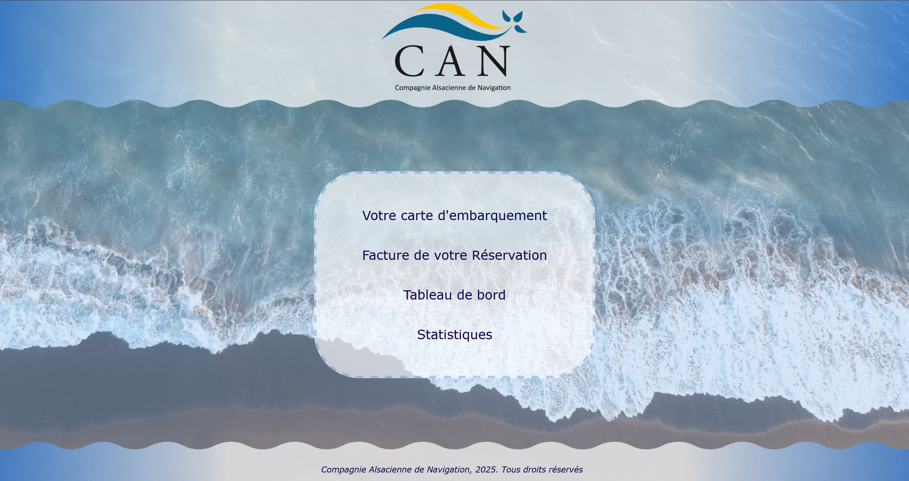
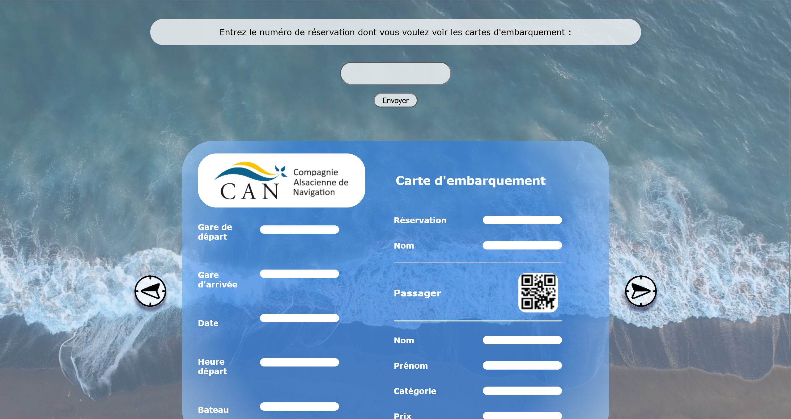

# ⛴️ Site de Réservation de Trajets en Bateau

> Site web de réservation de trajets en bateau développé dans le cadre d'un projet universitaire. Il propose une interface permettant de consulter et gérer des informations liées aux réservations, aux cartes d'embarquement et à la facturation, avec une application C# associée pour alimenter les données du site.

---





---

## 📖 À propos du projet

Ce projet consiste à développer un site web pour une compagnie fictive de navigation : la **Compagnie Alsacienne de Navigation (CAN)**.

L'application regroupe une interface web réalisée en HTML, CSS et JavaScript ainsi qu'un programme en C# permettant d'ajouter des informations de réservation dans une base de données au format JSON utilisée par le site.

Le projet a été réalisé dans le cadre d'une SAE universitaire.

---

## ✨ Fonctionnalités

### 🚢 Gestion des réservations

- Consultation des informations liées aux réservations.
- Recherche d'une réservation à partir de son numéro.
- Récupération des informations des passagers.
- Exploitation des données stockées au format JSON.

### 🎫 Cartes d'embarquement

- Consultation des cartes d'embarquement à partir d'un numéro de réservation.
- Affichage des informations du trajet :
  - Port de départ et d'arrivée.
  - Date et heure de départ.
  - Nom du bateau.
- Affichage des informations des passagers.
- Navigation entre les différentes cartes d'embarquement.

### 🧾 Facturation

- Consultation des factures associées aux réservations.
- Affichage des informations relatives aux trajets et aux passagers.

### 📊 Tableau de bord et statistiques

- Interface de tableau de bord.
- Consultation des informations de gestion.
- Affichage de statistiques liées à l'activité de la compagnie.

### 🖥️ Application de gestion en C#

- Application Windows développée en C#.
- Ajout d'informations de réservation.
- Enregistrement des données dans une base de données JSON.
- Utilisation des données par le site web.

---

## 🚀 Installation et exécution

### Prérequis

- Un navigateur web récent (Firefox, Chrome, Edge...).
- Windows pour utiliser l'application de gestion C#.
- Le dépôt Git du projet.

### Cloner le dépôt

```bash
git clone https://github.com/Amandine-Miranda/Site-Reservation-Trajets-Bateau.git
cd Site-Reservation-Trajets-Bateau
```

### Lancer le site web

1. Ouvrir le dossier du projet.
2. Localiser le fichier `accueil.html`.
3. Ouvrir ce fichier dans un navigateur web.
4. Naviguer entre les différentes rubriques du site.

### Lancer l'application C#

L'application de gestion est disponible dans le dépôt sous la forme d'un exécutable Windows :

```text
code.exe
```

Il suffit de lancer cet exécutable sur un environnement Windows compatible.

---

## ⚠️ État actuel du projet

**L'API utilisée initialement par le site n'existe malheureusement plus.**

Le site dépendait de cette API pour récupérer certaines informations relatives aux réservations et aux trajets.

Par conséquent :
- Certaines fonctionnalités nécessitant une communication avec l'API ne sont plus opérationnelles.
- La consultation dynamique des réservations et des cartes d'embarquement peut ne plus fonctionner.
- Le site peut toujours être ouvert dans un navigateur, mais son fonctionnement complet n'est plus garanti.

L'interface graphique, les pages HTML/CSS/JavaScript ainsi que le code source de l'application C# restent disponibles dans ce dépôt.

---

## 📂 Structure du projet

```text
Site-Reservation-Trajets-Bateau/
│
├── img/                # Images et ressources graphiques
│
├── ressources/         # Ressources et données du projet
│
├── scripts/            # Scripts JavaScript
│
├── accueil.html        # Page d'accueil
├── embarquement.html   # Cartes d'embarquement
├── facture.html        # Facturation
├── tableauBord.html    # Tableau de bord
├── statistiques.html   # Statistiques
│
├── style.css           # Feuille de style du site
│
├── code.cs             # Code source de l'application C#
├── code.exe            # Exécutable de l'application C#
│
└── README.md
```

---

## 🛠️ Technologies utilisées

- **HTML5** : structure des pages web.
- **CSS3** : mise en forme et interface graphique.
- **JavaScript** : interactions et traitement des données côté client.
- **C#** : développement de l'application Windows de gestion.
- **JSON** : stockage des informations de réservation.

---

## 👩‍💻 Réalisé par

**Amandine Miranda**, en collaboration avec **Léo Galien** et **Fanny Hertz**.

Projet universitaire réalisé dans le cadre d'une SAE.

---

## 📄 Licence

Ce projet est distribué sous licence MIT.
